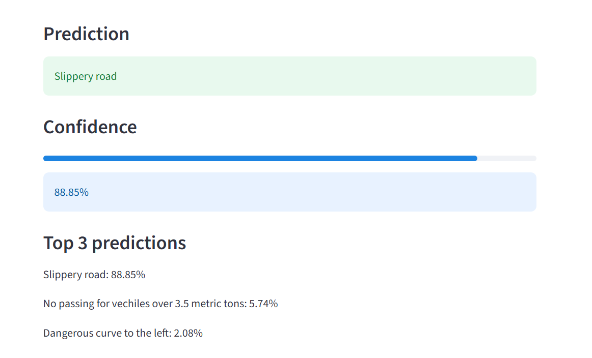
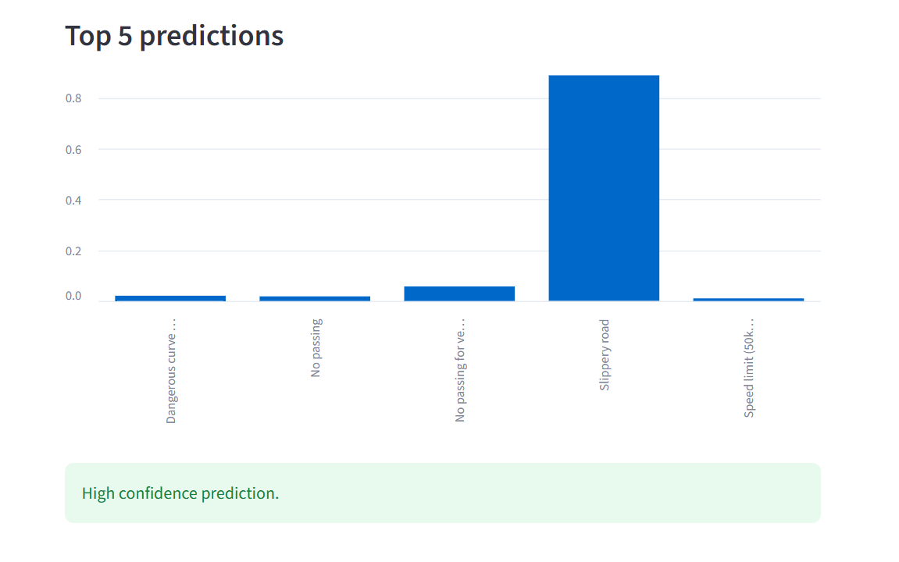
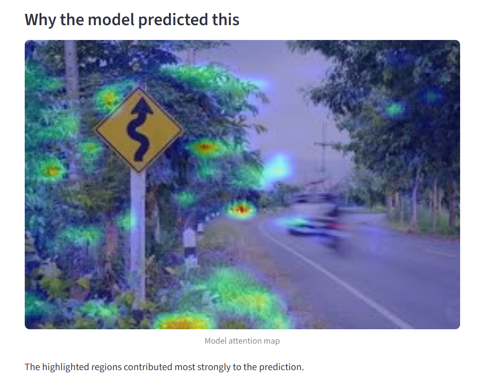
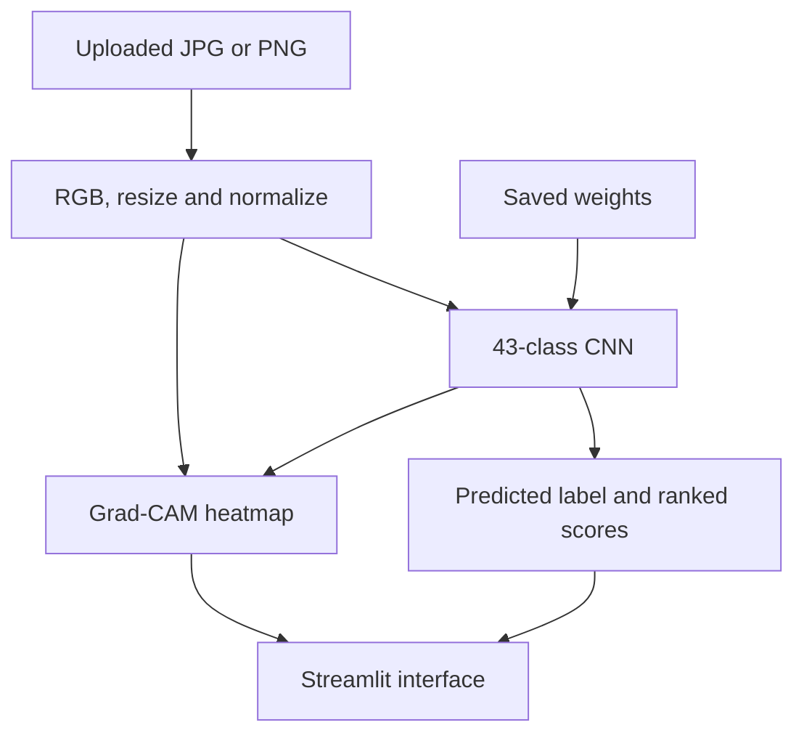

# 🚦 Traffic Sign Recognition & Explainable AI

A **43-class CNN image classifier** with a Streamlit interface, ranked predictions, confidence visualization, and Grad-CAM heatmaps.

    

[Overview](#-project-overview) · [Demo](#-interface-preview) · [Architecture](#-architecture) · [Quick start](#-quick-start) · [Engineering](#-engineering-decisions) · [Author](#-author)

---

## 🎯 Project overview

This project explores how to make an image classifier useful beyond a notebook: accept an uploaded image, prepare it consistently, display alternative predictions, and let the user inspect a visual explanation.

Traffic-sign recognition is relevant to transportation and driver-assistance research. Here, it is implemented as an **interactive computer vision prototype** for exploring predictions and model behavior.

## 🏆 Project highlights

- **43 traffic-sign classes** predicted by a TensorFlow/Keras CNN.
- **Top-3 predictions** and a **top-5 score chart**, alongside the predicted label.
- **Grad-CAM overlays** for inspecting regions that influence a class prediction.
- **Consistent preprocessing:** RGB conversion, 50 × 50 resizing, normalization, and batching.
- **Deployment-focused model loading:** rebuild the architecture, load saved weights, and initialize the graph for explanation.
- **User feedback:** setup errors, explanation failures, and low-confidence predictions are surfaced in the interface.

## 🖼️ Interface preview

### Predictions



<details>
<summary>View confidence and Grad-CAM examples</summary>





</details>

## 🏗️ Architecture



### CNN design

| Stage | Implementation |
| --- | --- |
| Input | 50 × 50 RGB image |
| Convolution block 1 | Conv2D, 64 filters; BatchNormalization; MaxPooling; Dropout 0.25 |
| Convolution block 2 | Conv2D, 64 filters; BatchNormalization; MaxPooling; Dropout 0.25 |
| Classification head | Flatten; Dense 128; Dropout 0.5; Dense 43 with softmax |

See [model architecture](Src/model_architecture.py) and the [training notebook](Notebooks/Traffic_Sign_Classification.ipynb).

## 🚀 Quick start

Clone the repository and create a virtual environment:

```bash
git clone https://github.com/IBOSS24/Traffic_sign_classification.git
cd Traffic_sign_classification
python -m venv .venv
```

Activate it with `source .venv/bin/activate` on Linux/macOS or `.\.venv\Scripts\Activate.ps1` in Windows PowerShell, then run:

```bash
python -m pip install --upgrade pip
python -m pip install -r requirements.txt
python -m streamlit run app.py
```

Open the local URL printed by Streamlit and upload a JPG or PNG. The application requires the included `Model/traffic.weights.h5` and `class_names.json` files. Dependencies include TensorFlow 2.16.1; a fresh environment installation was not verified as part of this documentation refresh.

## ⚙️ Engineering decisions

| Decision | Purpose |
| --- | --- |
| Rebuild architecture and load weights | Keep inference architecture explicit and avoid relying solely on full-model deserialization |
| Compatibility fallback for weight loading | Handle supported Keras HDF5 layouts when the standard loader raises a ValueError |
| Initialize the model with a dummy input | Prepare the model graph before generating explanations |
| Cache the model and class names | Avoid repeated loading during Streamlit reruns |
| Separate preprocessing, model loading, Grad-CAM, and utilities | Keep responsibilities readable and easier to maintain |
| Handle Grad-CAM errors separately | Preserve prediction output when explanation generation fails |

The interface marks predictions below a **0.60 softmax score** as low confidence. This is a display heuristic, not a calibrated reliability guarantee. Grad-CAM helps inspect influential regions; it does not prove that the prediction is correct.

## 📊 Evaluation and scope

The notebook contains the training work. A concise, reproducible evaluation report should document held-out performance, class-level errors, and robustness to changes in lighting, viewpoint, and image quality.

| Evaluation area | Question to answer |
| --- | --- |
| Per-class precision and recall | Which signs are confused or missed? |
| Confusion matrix | Which mistakes deserve closer investigation? |
| Calibration | Do predicted scores reflect observed correctness? |
| Inference latency | How responsive is the application on a stated device? |
| Robustness | What happens with blur, poor lighting, or unfamiliar inputs? |

The app is a single-image prototype. Safety-critical driving use would require broader validation, temporal processing, and system-level safeguards.

## 📂 Repository guide

| Path | Contents |
| --- | --- |
| [app.py](app.py) | Streamlit interface and inference orchestration |
| [Src/preprocessing.py](Src/preprocessing.py) | RGB conversion, resizing, normalization, and batching |
| [Src/model_architecture.py](Src/model_architecture.py) | CNN definition and weight loading |
| [Src/gradcam.py](Src/gradcam.py) | Heatmap generation and overlay |
| [Src/utils.py](Src/utils.py) | Class names and ranked predictions |
| [Model/](Model/) | Saved model weights |
| [Notebooks/](Notebooks/) | Training notebook |
| [Images/](Images/) | Interface screenshots |
| [requirements.txt](requirements.txt) | Pinned application dependencies |

## 🔭 Next steps

- Publish a reproducible evaluation summary and investigate class-level errors.
- Compare the baseline CNN with transfer learning.
- Add automated preprocessing and inference checks.
- Package the app with Docker and add CI.
- Explore model compression and deployment monitoring.

---

## 👨‍💻 Author

**Mohammed Badr**  
State-qualified engineer · Moroccan Royal Navy officer · Building a career in maritime Data Science & ML Engineering

I bring experience at sea and in maritime command centers to my work in applied machine learning. My focus is developing reliable ML systems and applying them to maritime traffic forecasting, vessel behavior analysis, and equipment reliability.

[](https://github.com/IBOSS24/Portfolio_)
[](https://www.linkedin.com/in/mohammed-e-a13664182)
[](#contact)

<a id="contact"></a>

## 📬 Contact

<details>
<summary>Show email and contact details</summary>

- **Email:** med.marin17@gmail.com
- **Gmail:** [Compose an email in Gmail](https://mail.google.com/mail/?view=cm&fs=1&to=med.marin17%40gmail.com)
- **Mail app:** [med.marin17@gmail.com](mailto:med.marin17@gmail.com)
- **LinkedIn:** [Mohammed E.](https://www.linkedin.com/in/mohammed-e-a13664182)
- **GitHub:** [IBOSS24](https://github.com/IBOSS24)
- **Portfolio:** [View my projects](https://github.com/IBOSS24/Portfolio_)

</details>
